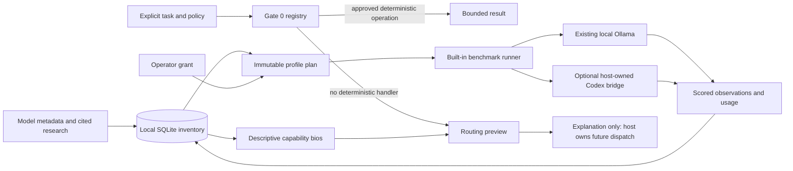

# Alpha scope and architecture

The `0.3.2a1` candidate preserves the tested core. Release preparation adds no live routing, provider transport, scheduler, service or retrieval architecture.

Research precedes planning. Plans bind model/backend identity, native settings, research, suite and scorer versions. Attempts are persisted before external work; observations produce partial bios immediately. Unknown completion is never automatically replayed. Resume retains spent attempt/time budgets.

Six baseline categories cover coding, review, supplied-source research, planning, structured extraction and orchestration. Additional settings get coding/structured contrasts. Native fixtures require structured calls to a fixed pure lookup handler. Generated code is never executed. Isolated Codex completions have no native tool surface.

Gate 0 extensions use `Gate0Registry` and `HandlerSpec` from `gcb.gate0`. Registration requires trusted developer approval; validators and permissions are explicit. Unknown operations decline, invalid input is denied, and handler failure does not implicitly invoke a model. Python extensions are trusted code, not a sandbox. See [interfaces](INTERFACES.md).

The router filters research, native identity, availability, authorization, locality, allowlists, modalities, tools and requested capacity. Comparable fixtures inform ordering. Equal-quality GPT observations use stable IDs, not inferred speed or cost; complete real local-model receipts can break an appropriate latency tie. Eligibility alone is not proof of task performance.

SQLite is the sole storage engine. CLI, Python and opt-in MCP interfaces share the dependency-free core. The optional JavaScript bridge is installed into an existing host. Private operator scripts and historical operational records are excluded from the public candidate.
